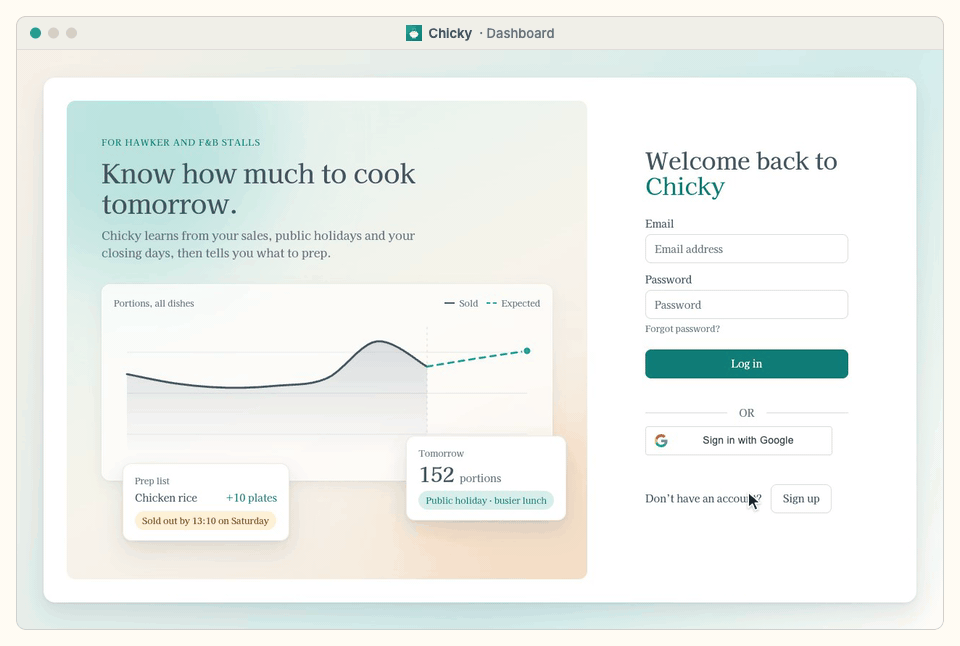
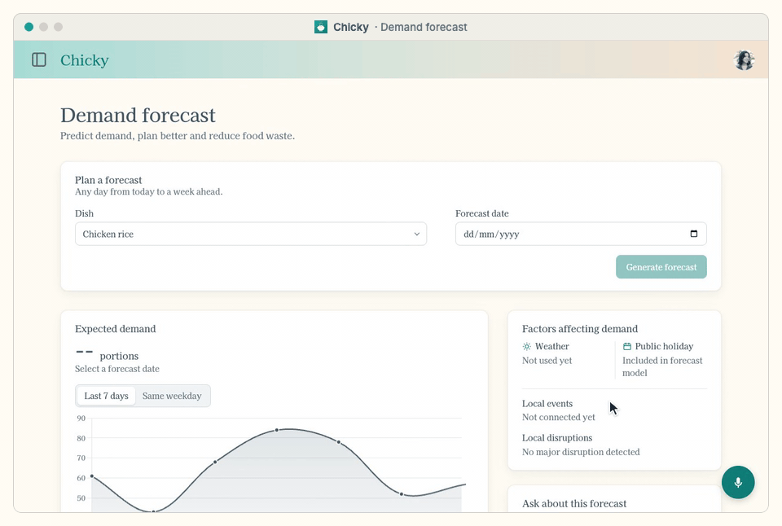
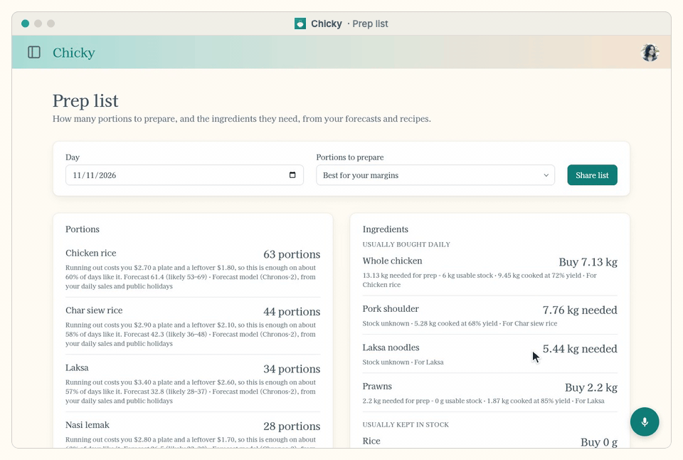
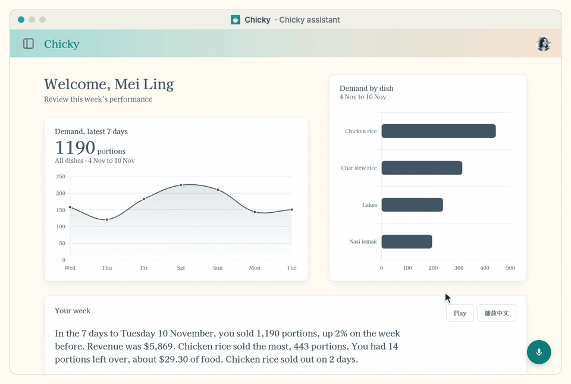
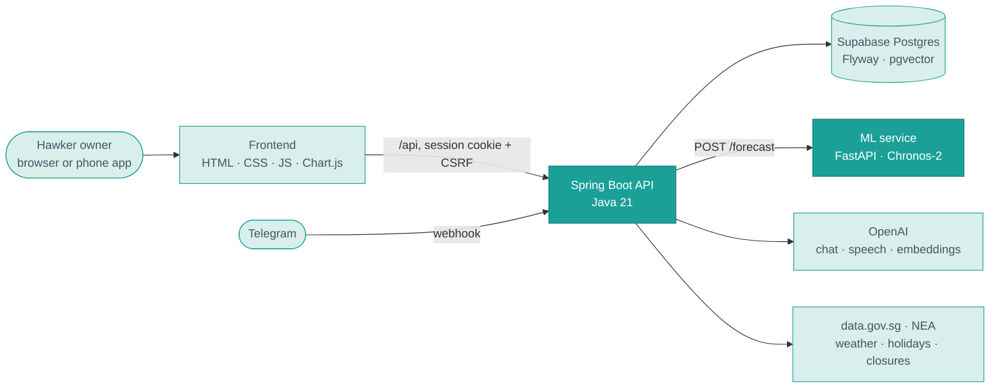

<p align="center">
  <a href="https://chicky-app.duckdns.org">
    <picture>
      <source media="(prefers-color-scheme: dark)" srcset="docs/readme/hero-dark.svg">
      
    </picture>
  </a>
</p>

<p align="center">
  <a href="https://github.com/OccupiedPorcupine/CS203-Vincent-s-Disciples/actions/workflows/ci.yml"></a>
  
  
  
  
  
</p>

<p align="center">
  <a href="https://chicky-app.duckdns.org">
    <picture>
      <source media="(prefers-color-scheme: dark)" srcset="docs/readme/button-live-dark.svg">
      
    </picture>
  </a>
</p>

<p align="center">
  <a href="#why-chicky">Why Chicky</a> ·
  <a href="#features">Features</a> ·
  <a href="#see-it-in-action">See it in action</a> ·
  <a href="#how-it-works">How it works</a> ·
  <a href="#run-it-yourself">Run it yourself</a> ·
  <a href="#team">Team</a>
</p>

<p align="center"></p>

## Why Chicky

Every morning a hawker decides how much to cook. Cook too little and the stall sells out by
lunch; cook too much and the rest goes in the bin. Most owners decide from memory.

Chicky learns from a stall's own daily sales, public holidays and closures, forecasts tomorrow's
demand for each dish, and turns it into a prep list with the ingredients to buy. An assistant
answers questions about all of it, by text or by voice.

> [!NOTE]
> In our simulator of 24 hawker stalls, preparing by Chicky's Chronos-2 forecast earns
> **83.7%** of the best possible profit, against **80.2%** for the owners' own habits. The
> simulator measures our own assumptions, so pilot data is what will show the gain for real
> stalls. The method and results are in [ml/README.md](ml/README.md).

## Features

<table>
  <tr>
    <td width="33%" valign="top">
      <br>
      <b>Demand forecasts</b><br>
      Chronos-2 forecasts each dish up to 7 days ahead, with a likely range and a plain-words
      reason. With too little history, a simple baseline steps in.
    </td>
    <td width="33%" valign="top">
      <br>
      <b>Prep lists</b><br>
      How many portions to prepare and the ingredients they need, from your forecasts and
      recipes. Dishes with a price and cost are prepared by margin.
    </td>
    <td width="33%" valign="top">
      <br>
      <b>Voice and chat assistant</b><br>
      Ask by typing or speaking. It answers from your own sales and forecasts, can record
      sales for you, and reads its replies aloud.
    </td>
  </tr>
  <tr>
    <td width="33%" valign="top">
      <br>
      <b>Your own documents</b><br>
      Upload supplier cut-offs, helper rules or what to do when the gas runs out. The assistant
      answers from them and says which document it used.
    </td>
    <td width="33%" valign="top">
      <br>
      <b>Holidays, closures and rain</b><br>
      Public holidays from data.gov.sg, NEA hawker centre cleaning dates and your own rest days.
      When showers are forecast and your rainy days sell differently, the dashboard says so.
    </td>
    <td width="33%" valign="top">
      <br>
      <b>On your phone</b><br>
      Install it on the home screen. Record sales from Telegram by message or voice note, and
      ask <code>/today</code>, <code>/prep</code> or <code>/forecast</code> from the chat.
    </td>
  </tr>
</table>

## See it in action

<h3 align="center">Sign in and see your week</h3>
<p align="center">
  
</p>

<h3 align="center">Forecast tomorrow's demand</h3>
<p align="center">
  
</p>

<h3 align="center">Know what to prepare</h3>
<p align="center">
  
</p>

<h3 align="center">Just ask</h3>
<p align="center">
  
</p>

## How it works



**A forecast, step by step**

1. The owner picks a dish and a date. The backend checks that the dish is theirs.
2. It gathers the dish's daily sales before that date, plus public holidays and closures.
3. With enough history, it asks the ML service, which runs Chronos-2 and returns a forecast
   with a likely range. Otherwise, or if the ML service is down, a baseline forecaster answers.
4. The prep list turns the forecast into portions and ingredients, using the dish's margin when
   its price and cost are known.

| Part | Built with | Read more |
| --- | --- | --- |
| Frontend | Plain HTML, CSS and JavaScript, Chart.js, no build step | [frontend/README.md](frontend/README.md) · [DESIGN.md](frontend/DESIGN.md) |
| Backend | Java 21, Spring Boot, Spring Security, Spring Data JPA | [backend/README.md](backend/README.md) |
| Database | Supabase Postgres with Flyway migrations and pgvector; H2 for local runs and tests | [database/README.md](database/README.md) |
| Forecasting | Python, FastAPI, Chronos-2 (PyTorch), CatBoost, pandas | [ml/README.md](ml/README.md) |
| Assistant | OpenAI chat, transcription, speech and embeddings, with an eval suite | [assistant-eval/README.md](assistant-eval/README.md) |
| Hosting | Docker on AWS EC2 (main) and Vercel (backup), GitHub Actions CI | [deploy/README.md](deploy/README.md) |

## Run it yourself

<details>
<summary><b>Quick start</b>: backend, frontend and demo data in four commands</summary>

<br>

You need Java 21, Node.js and Python 3. From the repository root:

```sh
# 1. Backend on http://localhost:8080 (in-memory H2 database)
cp backend/.env.example backend/.env
(cd backend && ./mvnw spring-boot:run)

# 2. Frontend on http://localhost:5500, in a second terminal
node frontend/server.mjs

# 3. Demo data, in a third terminal: signs in as demo@chicky.test / chicky-demo-password
python3 scripts/seed_demo_data.py
```

Open <http://localhost:5500> and sign in with the demo account.

> [!NOTE]
> The H2 database is wiped every time the backend restarts, so run the seed script again after
> a restart. To keep data, connect to Supabase as described in [database/README.md](database/README.md).

> [!TIP]
> Without the ML service, forecasts come from the baseline forecaster. To get Chronos-2
> forecasts, start the ML service on port 8000 as described in [ml/README.md](ml/README.md).

> [!WARNING]
> `backend/.env` holds secrets such as API keys and database passwords. It is gitignored, so
> keep it that way.

</details>

<details>
<summary><b>Run the tests</b></summary>

<br>

```sh
(cd backend && ./mvnw verify)        # backend tests on H2
python -m pytest ml/tests scripts/tests  # ML and script tests
```

CI runs these on every pull request and push to main. It also applies the migrations to a real
Supabase Postgres and checks the AWS deployment configuration.

</details>

<p align="center"></p>

## Team

Built for SMU CS203 by Vincent's Disciples.

<table>
  <tr>
    <td align="center" width="25%">
      <a href="https://github.com/OccupiedPorcupine"><br><sub><b>OccupiedPorcupine</b></sub></a>
    </td>
    <td align="center" width="25%">
      <a href="https://github.com/anniele2006"><br><sub><b>anniele2006</b></sub></a>
    </td>
    <td align="center" width="25%">
      <a href="https://github.com/elvapeh2025-smu"><br><sub><b>elvapeh2025-smu</b></sub></a>
    </td>
    <td align="center" width="25%">
      <a href="https://github.com/miniminhanh"><br><sub><b>miniminhanh</b></sub></a>
    </td>
  </tr>
</table>

<p align="center">
  <picture>
    <source media="(prefers-color-scheme: dark)" srcset="docs/readme/footer-dark.svg">
    
  </picture>
</p>
