# Chicky design language

How Chicky looks and why, so new screens match the existing ones. If you are adding UI, read
[the checklist](#checklist-for-new-ui) at the end first.

| Where | What |
| --- | --- |
| [css/base.css](css/base.css) | Design tokens and every shared component. Load it first on every page. |
| [js/chart-theme.js](js/chart-theme.js) | Chart.js colours and fonts, read from the tokens. |
| [js/app-shell.js](js/app-shell.js) | Header behaviour shared by every signed-in page: menus and the account menu. |
| [design/styleguide.html](design/styleguide.html) | Live reference of all tokens and components. Open it with the dev server running. |
| [design/screenshots/](design/screenshots/) | Reference screenshots of every page, regenerated by [design/capture-screenshots.cjs](design/capture-screenshots.cjs). |

Page stylesheets (`dashboard.css`, `forecast.css`, `data.css`, `styles.css`) contain **layout
only**. A colour, font size, radius or shadow that isn't a token is a smell: add or reuse a token
in `base.css` instead.

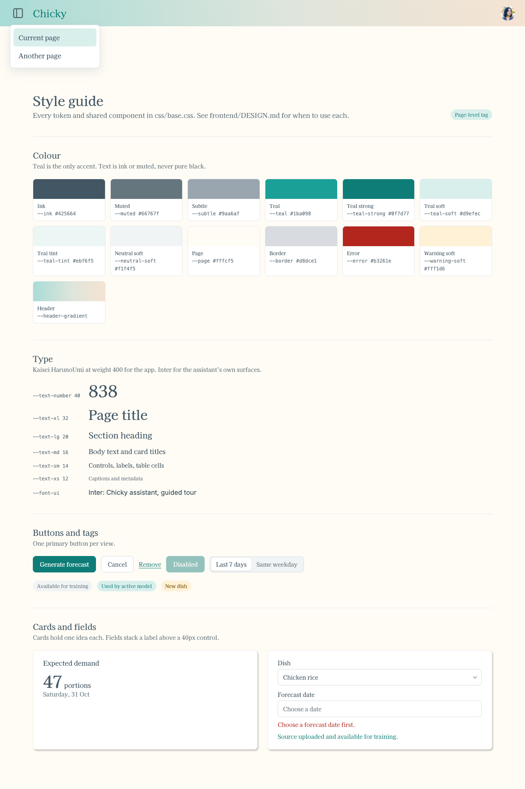

## Character

Chicky is a planning tool for hawker and F&B owners. It should feel calm, warm and a little
hand-made, not like an analytics dashboard.

- **Warm, quiet surfaces.** A cream page (`--page`), white cards with a soft shadow, and one
  gradient: the header, which runs from teal to sand.
- **One accent.** Teal marks what is interactive, selected or predicted. Everything else is ink
  on cream. Don't introduce a second accent colour; use the status colours only for status.
- **A serif voice.** Kaisei HarunoUmi at regular weight carries the whole app, headings included.
  Hierarchy comes from size and colour, never bold.
- **Plain words.** Sentence case, short labels, no jargon (see [Writing](#writing)).

## Pages

Every signed-in page has the same skeleton:

```
header.topbar      menu (details.navigation) · Chicky wordmark · account (details.account-menu)
main.page          max 1120px wide, centred
  .page-heading    h1 + p.lede (optional tag or action on the right)
  content          cards and/or .section blocks
assistant bubble   added by js/assistant.js, bottom right
```

| Dashboard | Demand forecast |
| --- | --- |
| 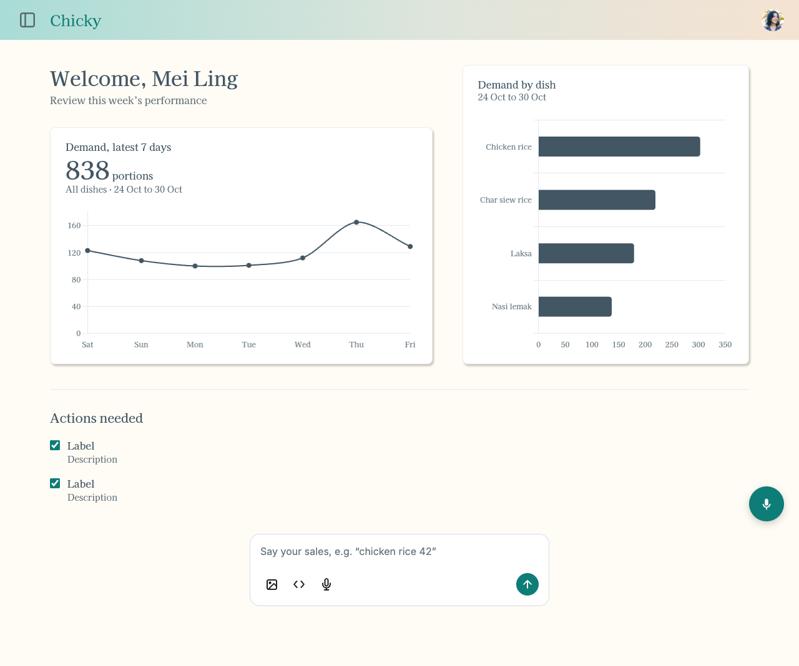 | 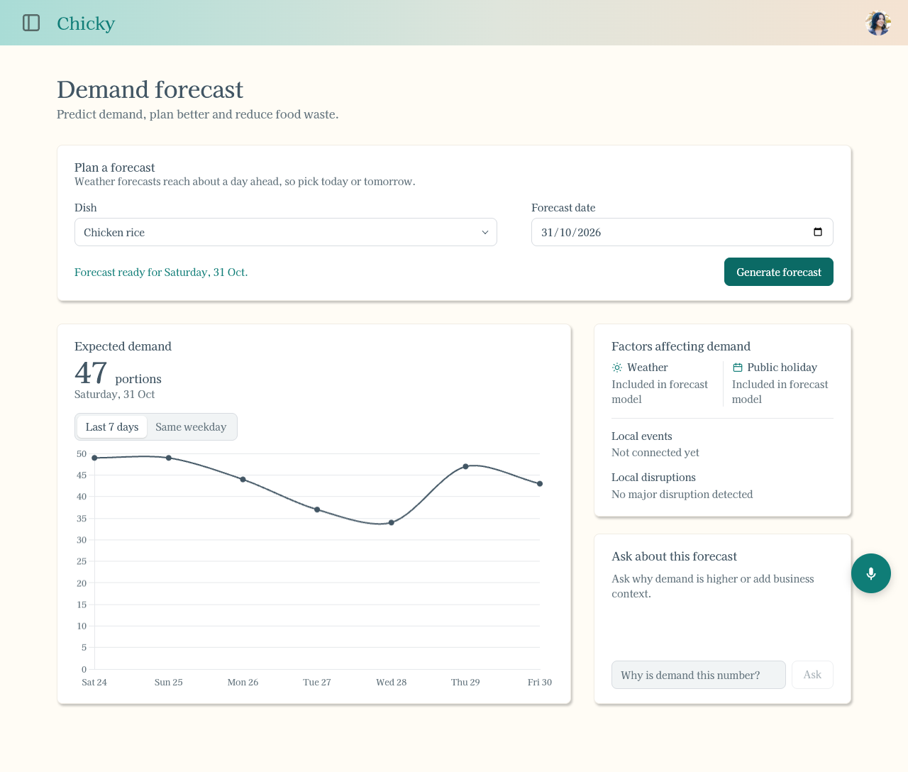 |

| Data ingestion | Sign in |
| --- | --- |
| 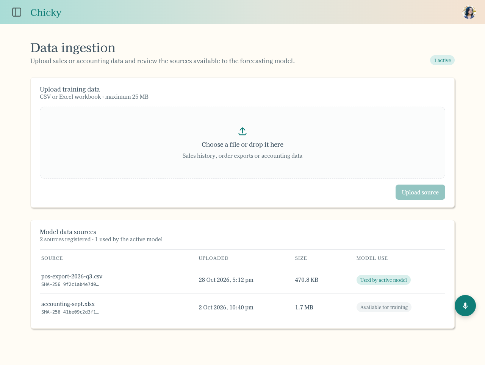 | 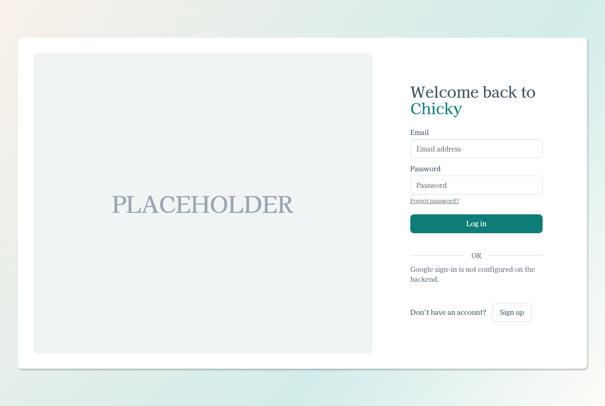 |

The sign-in page is the exception: no header, one centred card on the soft brand gradient.

### Getting around

**Every page must be reachable from every other page.** The rule:

- **Top-level pages** (Dashboard, Demand forecast, Prep list, Data ingestion, Dishes) are listed in the top-left menu
  on **every** signed-in page, in that order, with those labels. The current page is in the list
  too, with `aria-current="page"`; the others get `data-guide-id="nav-<page>"` so the guided tour
  can point at them.
- **Subpages** (a page that only makes sense inside another, such as one dish's history) don't go
  in the menu. Link to them from their parent page, and give them a way back: a "← Dashboard"
  style text link above the `h1`, naming the parent.
- **Account** lives in the avatar menu at the top right: the user's name, email and Log out, which
  returns to the sign-in page. Signing in lands on the Dashboard.
- The wordmark links to the Dashboard.

Menus are `<details>` elements. `js/app-shell.js` keeps only one open at a time and closes them on
an outside click or Escape, so new header menus get that for free if they live in `.topbar`.

```
Sign in ──► Dashboard ◄──► Demand forecast ◄──► Prep list ◄──► Data ingestion ◄──► Dishes
               ▲            (menu on every page links all five)                  ▲
               └──────────────────── avatar menu: Log out ──► Sign in
```

| Page menu | Account menu |
| --- | --- |
| 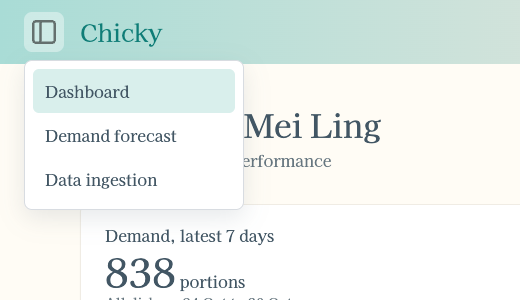 | 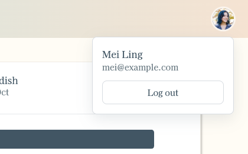 |

## Colour

All colours are tokens in `base.css`. Don't write hex values in page stylesheets.

| Token | Value | Use for |
| --- | --- | --- |
| `--ink` | `#425664` | Text, icons, recorded data in charts |
| `--muted` | `#66767f` | Secondary text: ledes, captions, notes, placeholders |
| `--subtle` | `#9aa6af` | Decorative or switched-off icons. Never text (fails contrast) |
| `--teal` | `#1ba098` | Brand accent: focus ring, selected outlines, predictions, icon fills, highlight ring |
| `--teal-strong` | `#0f7d77` | Teal **behind or as text**: primary buttons, user chat bubbles, links, success text, the wordmark |
| `--teal-hover` | `#0b6a65` | Hover on `--teal-strong` fills |
| `--teal-soft` | `#d9efec` | Selected state (current menu item, active tag) |
| `--teal-tint` | `#ebf6f5` | Hover state on light surfaces |
| `--neutral-soft` | `#f1f4f5` | Neutral hover, inactive tags, segmented track, assistant bubbles |
| `--border` | `#d8dce1` | Outlines of controls, menus and dashed drop zones |
| `--divider` | `#e6e8eb` | Rules between rows, sections and chart gridlines |
| `--page` | `#fffcf5` | Page background |
| `--surface` | `#fff` | Cards, controls, menus |
| `--surface-muted` | `#fbfcfc` | Inset areas inside a surface (drop zone, assistant confirm card) |
| `--error` / `--error-soft` | `#b3261e` / `#fdecea` | Error text / error message background |
| `--warning` / `--warning-soft` | `#7a4b00` / `#fff1d6` | Needs-attention tags such as "New dish" |
| `--header-gradient` | teal → sage → sand | The top bar only |

**Contrast.** `--ink`, `--muted`, `--teal-strong` and `--error` all pass WCAG AA (4.5:1) on
`--page` and `--surface`. Brand `--teal` is only 3.2:1 against white, so never put text in it or
white text on it. Use `--teal-strong` instead.

## Type

| Token | Size | Use for |
| --- | --- | --- |
| `--text-number` | 40px | The one key figure in a card ("838 portions") |
| `--text-xl` | 32px | Page title (`h1`), one per page. 28px on phones |
| `--text-lg` | 20px | Section heading (`.section-heading h2`) |
| `--text-md` | 16px | Body text and card titles (`.card-title`) |
| `--text-sm` | 14px | Controls, labels, table cells, notes |
| `--text-xs` | 12px | Captions, metadata, table headers, tags |

- **`--font-display` (Kaisei HarunoUmi)** is used everywhere on the page, always at weight 400.
- **`--font-ui` (Inter)** is used only on the assistant's own surfaces: the floating assistant
  panel, the guided-tour bubble and the dashboard's chat box (the large assistant input). The
  font switch tells users "this is the assistant talking", so keep Inter out of page content.
- Load both on every signed-in page:
  `https://fonts.googleapis.com/css2?family=Inter:wght@400;500;600&family=Kaisei+HarunoUmi&display=swap`
- Uppercase is only for table column headers (`--text-xs`, `letter-spacing: 0.08em`).

## Spacing, shape and depth

**Spacing** uses a 4px grid: 4, 8, 12, 16, 20, 24, 32, 40, 48. Common pairings:

- 4px between a label or title and its caption
- 8px between related controls (input + button, tags)
- 16–24px between cards in a column, and card padding (`20px 24px`)
- 32px between major blocks; 40px above a `.section`

**Radius**

| Token | Value | Use for |
| --- | --- | --- |
| `--radius-sm` | 6px | Things nested inside a control (segmented buttons, menu items) |
| `--radius-md` | 8px | Cards, buttons, inputs, menus |
| `--radius-lg` | 12px | Chat bubbles, drop zones, the tour bubble, cards inside the assistant |
| `--radius-xl` | 16px | Floating panels and the dashboard chat box |
| `--radius-pill` | 999px | Tags; circles use `50%` |

**Shadow**

| Token | Use for |
| --- | --- |
| `--shadow-card` | Cards sitting on the page |
| `--shadow-menu` | Drop-down menus |
| `--shadow-float` | Things floating above everything: assistant panel and bubble, tour bubble |

**Control height** is `--control-height` (40px) for every input, select and button.

**Breakpoints.** Pages switch to one column at `max-width: 760px` (the dashboard at 800px), and
data tables collapse further at 520px. Keep a 16px side gutter on phones and never scroll sideways.

| Dashboard | Demand forecast | Data ingestion |
| --- | --- | --- |
| 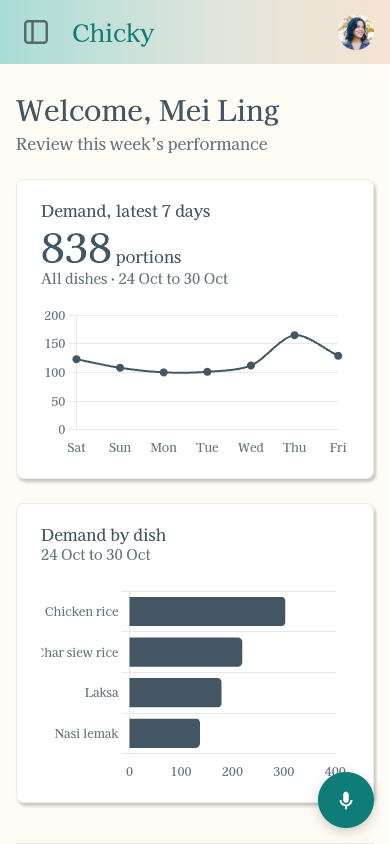 | 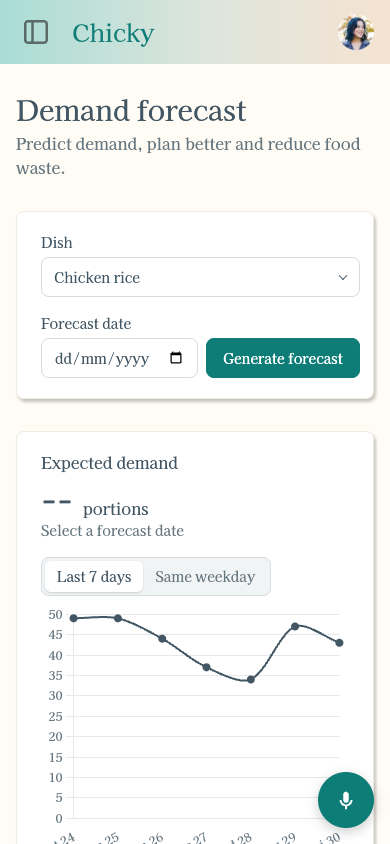 | 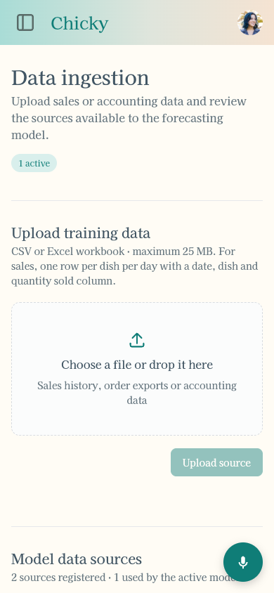 |

## Components

All of these are in `base.css` and shown in the style guide. Prefer them to new classes.

### Page heading and sections

```html
<section class="page-heading">
  <div>
    <h1>Data ingestion</h1>
    <p class="lede">Upload sales or accounting data and review the sources available to the forecasting model.</p>
  </div>
  <span class="tag is-active">1 active</span>   <!-- optional -->
</section>

<section class="section" aria-labelledby="upload-heading">
  <div class="section-heading">
    <h2 id="upload-heading">Upload training data</h2>
    <p>CSV or Excel workbook · maximum 25 MB</p>
  </div>
  …
</section>
```

A `.section` is separated by a divider line, not a card. Use sections for full-width page areas
and cards for side-by-side panels.

### Cards and headline figures

```html
<section class="card" aria-labelledby="demand-heading">
  <div class="headline">
    <h2 id="demand-heading" class="card-title">Demand, latest 7 days</h2>
    <span class="number">838<span class="unit"> portions</span></span>
    <span class="note">All dishes · 24 Oct to 30 Oct</span>
  </div>
  …
</section>
```

One idea per card. A card has at most one `.number`.

### Buttons

| Class | Use for |
| --- | --- |
| `.primary-button` | The main action of the view. **At most one visible at a time.** |
| `.secondary-button` | Other actions: Cancel, Sign up, Ask |
| `.text-button` | Low-emphasis inline actions: Remove, Log in (as a switch) |
| `.segmented` | Choosing between 2–4 views. Set `aria-pressed` on the buttons, not a class |

Disabled buttons fade to 45% opacity. While a button is working, change its label to an
ellipsis form ("Generating…") and restore the **same** label afterwards.

### Form fields

```html
<div class="field">
  <label for="dish-select">Dish</label>
  <div class="select-wrap">            <!-- only for <select> -->
    <select id="dish-select" class="input">…</select>
  </div>
</div>
```

Every input, select and date picker gets `.input`. Labels sit above the control, are short nouns
("Dish", "Forecast date"), and don't end in a colon.

### Feedback

- **Inline status:** `<p class="status-text" role="status" aria-live="polite">` under the thing it
  is about, with `.is-error` or `.is-success`. Progress messages ("Signing in…") have no modifier.
  **Don't use `alert()`.**
- **Tags:** `.tag` (neutral), `.tag.is-active` (in use, selected), `.tag.is-warning` (needs a look).
- **Empty states:** `.empty-state`, one sentence saying what will appear here and how to get it
  ("Upload the first data source to make it available for training.").
- **Loading:** put the loading message in the element that will hold the data ("Loading sales…",
  `--` for a number). No spinners.

### Charts

Charts use Chart.js through `js/chart-theme.js`. Load it right after Chart.js, then spread a preset
into each dataset:

```js
datasets: [{ label: "Portions sold", data, ...chickyChart.recordedLine }]
```

| Preset | Meaning |
| --- | --- |
| `recordedLine` / `recordedBar` | Sales that happened: solid `--ink` |
| `predictedLine` | Model output: dashed `--teal` |

That split is the whole chart vocabulary: **ink is what happened, dashed teal is what we expect.**
Gridlines are `--divider`, axis text is `--muted` in the display font, and legends are off (say
what the chart shows in the card title instead). Give every `<canvas>` `role="img"` and an
`aria-label` describing the chart.

### Assistant and guided tour

The assistant widget ([css/assistant.css](css/assistant.css)) and tour ([css/guide.css](css/guide.css))
sit above every page and use `--font-ui`. They read the shared tokens with fallbacks, so they still
render if a page forgets `base.css`.

| Assistant with a confirm card | Guided tour |
| --- | --- |
| 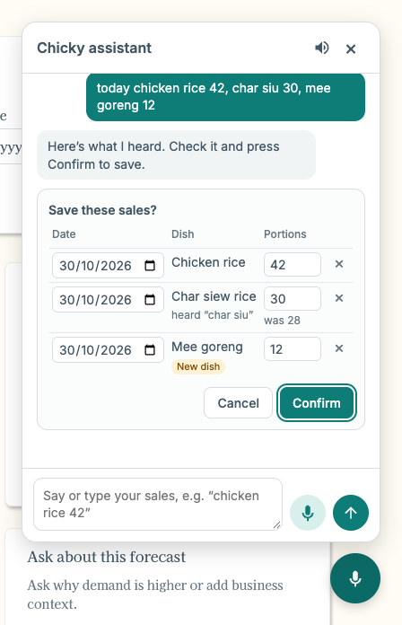 | 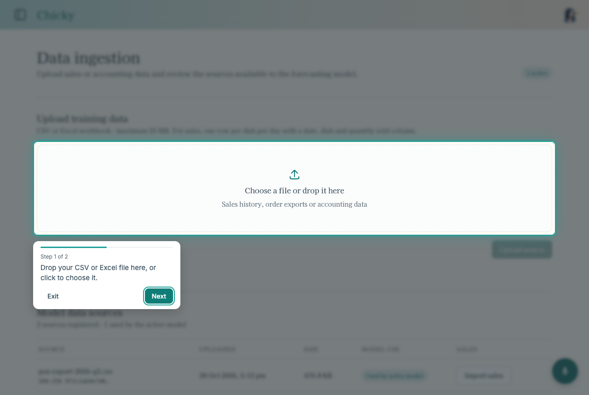 |

The tour is the app's most animated surface; see [Motion](#motion).

## Motion

Motion explains where something came from or went; it is never decoration. Everything eases out
(fast start, gentle stop) and stays short.

| Token | Value | Use for |
| --- | --- | --- |
| `--duration-fast` | 160ms | Menus opening, hover colour changes |
| `--duration-base` | 300ms | Fades, page changes, the tour closing |
| `--duration-slow` | 450ms | The tour's spotlight moving between elements |
| `--ease-out` | `cubic-bezier(0.2, 0.8, 0.2, 1)` | Things appearing or arriving |
| `--ease-in-out` | `cubic-bezier(0.65, 0, 0.35, 1)` | Things moving from one place to another |

**Moving between pages.** Pages cross-fade using the browser's View Transitions: the header stays
still while the old content lifts away and the new content rises in. Every page opts in with an
inline `<style>@view-transition { navigation: auto; }</style>` in its `<head>`, right after the
viewport meta. Copy that line into any new page; from a stylesheet, Chrome sometimes applies it too
late and skips the transition. Browsers without View Transitions just change page normally.

**Menus** fade and drop 4px into place.

**The guided tour** ([js/guide.js](js/guide.js)) moves through a sequence of states:

1. **Dim in.** The shade fades in while blurring and desaturating the page behind it, and the
   spotlight closes in from the edges of the screen onto the first element.
2. **Land.** The ring around the spotlight ripples twice to draw the eye. The bubble rises in with
   the step's text, and the progress bar fills to the current step.
3. **Glide.** On Next or Back, the spotlight and bubble glide together to the next element, following
   the page as it smooth-scrolls. The bubble picks its side from where it will end up, so it never
   flips halfway through.
4. **Leave.** When the next step is on another page, the bubble fades but the spotlight and ring stay
   exactly where they are. This also happens if the user clicks the highlighted link themselves.
5. **Arrive and morph.** The new page's first frame has the dim, blur and spotlight in the same
   place the last page left them, so the page cross-fades underneath an overlay that never cuts.
   The spotlight then morphs from there onto the next element. Back across pages works the same way.
6. **Exit.** On Exit, Done or Escape, the shade fades and un-blurs back to the page.

| Closing in | Landed | Leaving the page |
| --- | --- | --- |
| 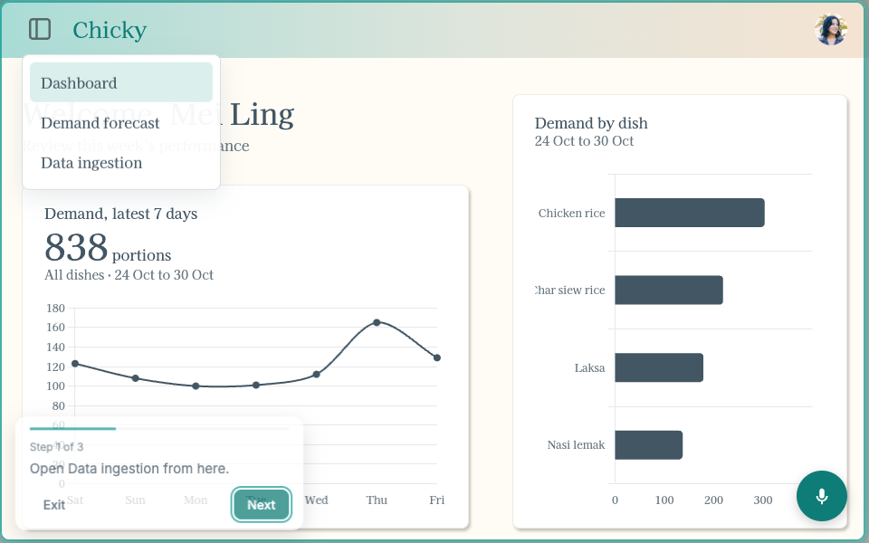 | 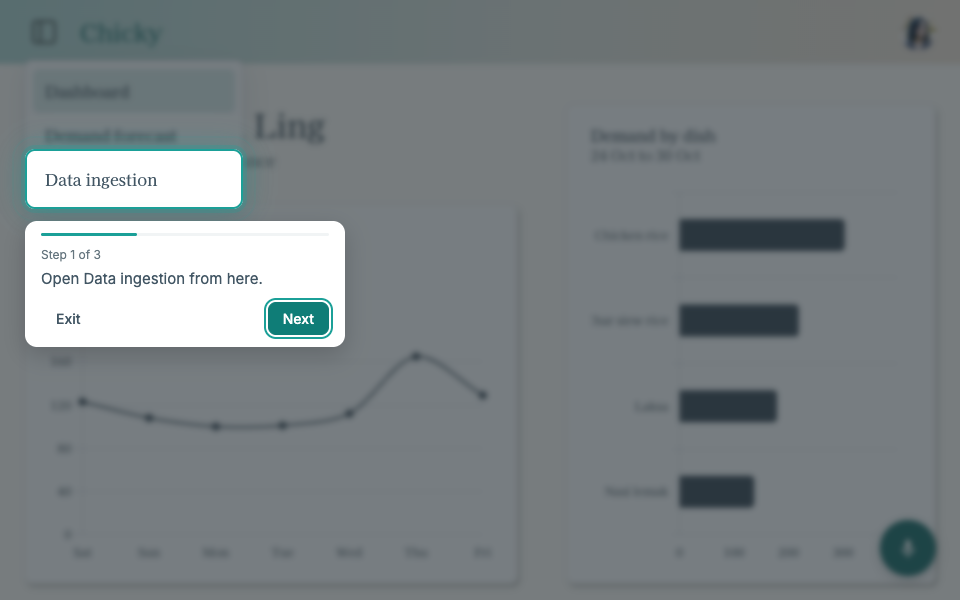 | 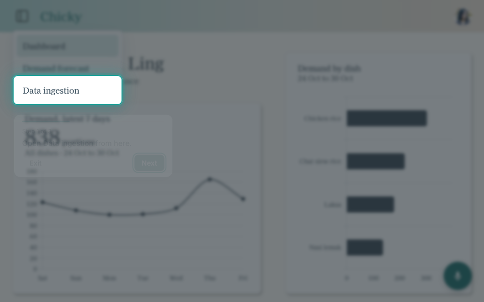 |

| Arriving: same spotlight, new page underneath | Morphing onto the next element | Arrived |
| --- | --- | --- |
| 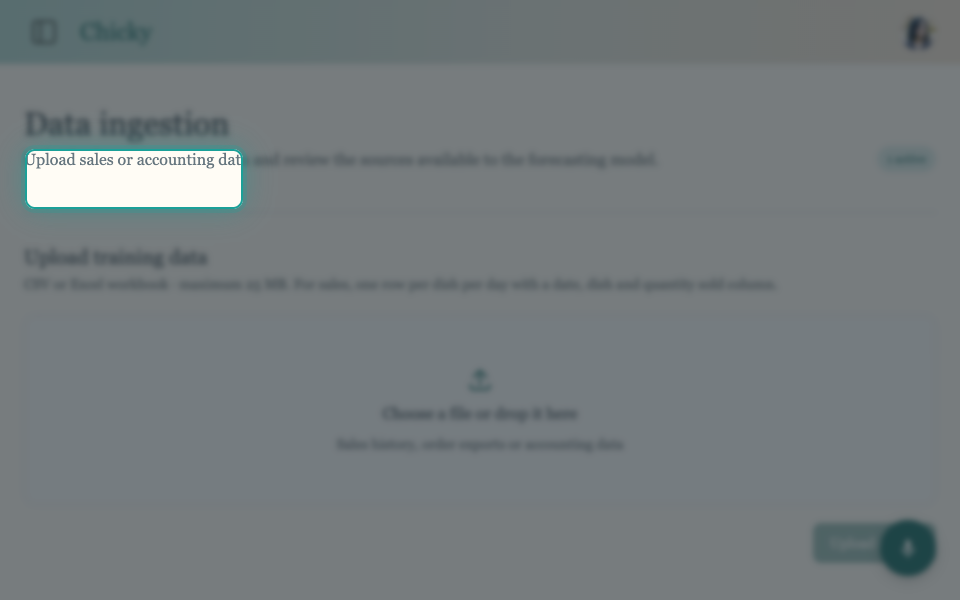 | 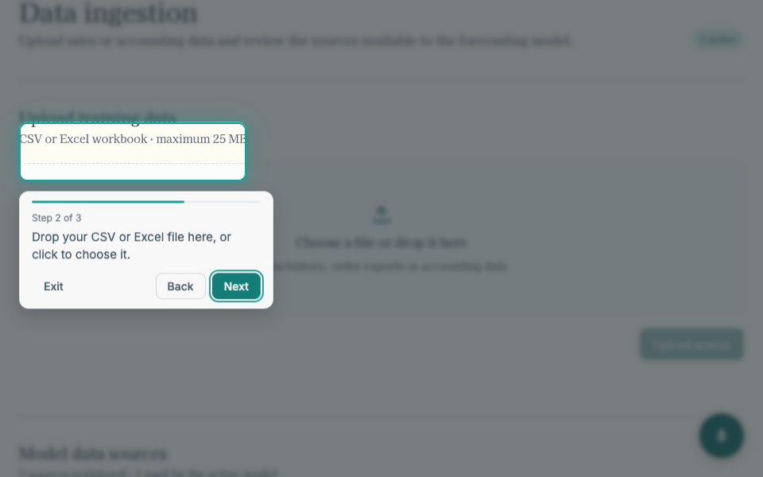 | 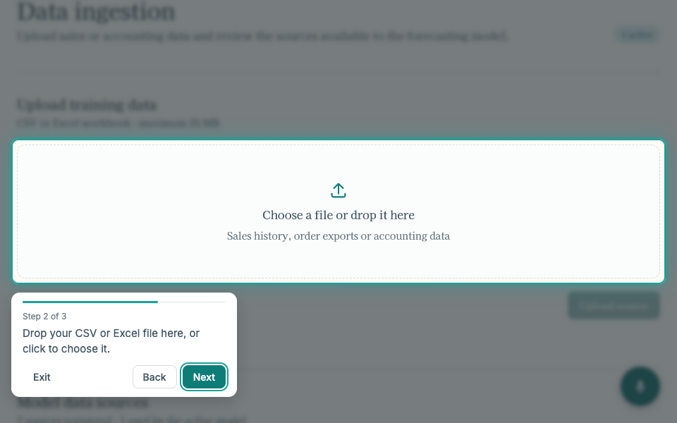 |

| Gliding to the next step on the same page |
| --- |
| 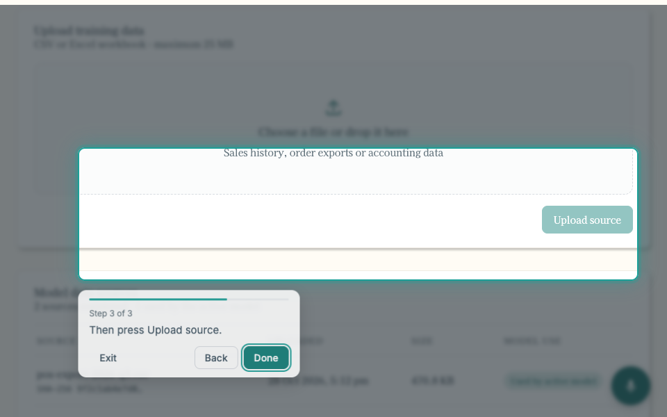 |

The spotlight is one shade with a rounded hole cut out by `clip-path`, redrawn each frame, so the
highlighted element stays clickable and nothing else is. The dim overlay never disappears or jumps
between steps, even across pages. Three pieces make that work, and each page needs all three:

1. `js/guide.js` saves the spotlight's position with the tour state when the page is hidden
   (`pagehide`), and draws it again as soon as the next page's `guide.js` runs.
2. Mid-tour, a one-line script in each page's `<head>` holds the first paint (a render-blocking
   `<link rel="expect" href="#guide-ready">`) until the `<span id="guide-ready" hidden>` placed right
   after `guide.js`. Without it, the browser shows the new page undimmed for a frame or two before
   the overlay is back.
3. Tours skip the page cross-fade, which would draw the new overlay without its blur and then snap.

**Reduced motion.** With `prefers-reduced-motion`, every transition and animation in `base.css`
collapses to an instant change, page cross-fades are off, and the tour jumps straight to each step.
Any new animation must do the same.

## Phones

Stall owners use Chicky on a phone at the stall, often one-handed. Every page must work at 375px
wide in Safari, and `frontend/tests/phone-check.cjs` checks that the main flow does (see
[README.md](README.md)).

- **No sideways scrolling.** Layouts go to one column at 760px.
- **Tap targets are at least 44px.** On touch screens (`@media (pointer: coarse)`)
  `--control-height` becomes 44px, and the menu, avatar, segmented buttons and assistant buttons
  grow to match. When you add a control, check it under that media query.
- **Text in fields is at least 16px on touch screens.** iOS zooms the whole page in when you tap a
  field with smaller text. `.input`, `select` and `textarea` get this from `base.css`; a field with
  its own font size needs its own rule.
- **Respect the iPhone's notch and home bar.** Pages use `viewport-fit=cover`, and anything
  pinned to an edge (the header, the assistant button and panel, the page's bottom padding) adds
  `env(safe-area-inset-*)`.
- **Nothing pinned may cover a control at the bottom of the page.** The page's bottom padding keeps
  the last controls clear of the assistant button.
- **Tables reflow.** Below 600px the assistant's confirm card puts each dish on its own line, with
  its date, portions and remove button beneath, instead of squeezing four columns.

**Home-screen app.** `manifest.webmanifest`, the icons in `images/icons/` (from `icon.svg`, rendered
by `design/render-icons.cjs`) and the `apple-touch-icon` link let people add Chicky to their home
screen, where it opens full screen. Every page links them; copy the block under "Home-screen app" in
a page's `<head>` into new pages. The icon is a placeholder until there's a logo.

## Interaction states

| State | Treatment |
| --- | --- |
| Hover | `--teal-tint` background on light items; `--teal-hover` on teal fills |
| Selected | `--teal-soft` background, or `aria-pressed="true"` on a segmented button |
| Focus | 2px `--teal` outline, 2px offset (global `:focus-visible` in `base.css`). Never remove it without a replacement |
| Disabled | 45% opacity, `cursor: not-allowed` |
| Error | `--error` text; `--error-soft` background only inside the assistant |

Drive state from ARIA attributes (`aria-pressed`, `aria-current`, `aria-expanded`) rather than
extra classes, so the look and the accessibility tree can't drift apart.

## Writing

- **Sentence case** for everything: titles, buttons, labels, menu items ("Generate forecast",
  "Actions needed", "Demand forecast").
- Use the user's words: "portions", "dishes", "sales". Avoid "items", "records" and "SKU".
- Format dates with `en-SG` (`30 Oct`, `Saturday, 31 Oct`).
- Use typographic characters: `…` not `...`, curly quotes “ ” and ’, middle dot `·` as a separator.
- Errors say what happened and what to do: "Couldn’t generate a forecast. Try again in a moment."

## Accessibility

- Every page has one `h1`, and headings don't skip levels.
- Icon-only buttons need an `aria-label`; decorative SVGs get `aria-hidden="true"`.
- Status text uses `role="status"` + `aria-live="polite"`.
- Keep text at 4.5:1 contrast or better (see [Colour](#colour)).
- Everything respects `prefers-reduced-motion` (see [Motion](#motion)).

## Checklist for new UI

1. Link `css/base.css` before the page stylesheet, load both fonts, and copy into the `<head>`: the
   viewport meta (with `viewport-fit=cover`), the inline `@view-transition` style, the tour
   paint-hold script and the home-screen app block. Put `<span id="guide-ready" hidden></span>`
   right after the `js/guide.js` script tag.
2. Use the page skeleton: shared `.topbar` (page menu, wordmark, account menu), `main.page`,
   `.page-heading`, and load `js/api.js` then `js/app-shell.js`.
3. Make it reachable: a top-level page goes in the menu on **every** page, in the same order; a
   subpage is linked from its parent and links back to it (see [Getting around](#getting-around)).
4. Reach for an existing component before writing CSS. Page CSS is layout only, with tokens for
   every colour, size, radius and shadow.
5. One primary button per view; sentence-case labels. Animations use the motion tokens and
   respect reduced motion.
6. Inline `.status-text` for feedback, never `alert()`.
7. Charts: load `js/chart-theme.js` and use its presets.
8. Add `data-guide-id` to anything the assistant should be able to point at, and describe it in
   `backend/src/main/resources/assistant/app-guide.json` (`AppGuideConsistencyTest` checks both).
9. Check it at 1280px and 375px wide, run `frontend/tests/phone-check.cjs` (add the page to it if
   it's part of a main flow), then regenerate the screenshots if the page appears here.

### Regenerating screenshots

Start the frontend (`node frontend/server.mjs`), then from the repo root:

```sh
npm install --prefix /tmp/chicky-pw playwright    # once, outside the repo
PW=/tmp/chicky-pw/node_modules/playwright node frontend/design/capture-screenshots.cjs
```

The script mocks the API, so no backend or login is needed.

## Known gaps

- The sign-in page's left panel is still a "PLACEHOLDER" block waiting for artwork.
- Dashboard "Actions needed" items and the forecast "Ask about this forecast" card are placeholders
  that aren't connected yet. When they are, keep the components above.
- The dashboard chat box's attach and code buttons don't do anything yet.
